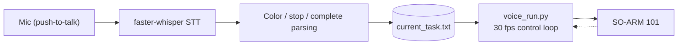

# Speech-Driven-VLA-Robotics

Voice-controlled pick-and-place on a low-cost **SO-ARM 101** arm, driven by fine-tuned **SmolVLA** vision-language-action policies.

Say a color — the matching policy takes over the arm, picks up that ball and puts it in the box. Say "stop" and the arm eases back to home; say "complete" and the runner exits.

**Result: 9 / 12 end-to-end successes (75%) on the real robot**, counting only trials where the ball of the spoken color was grasped *and* placed in the box.

## Demo

| Trial video 1 | Trial video 2 |
|---|---|
| [](https://youtu.be/n0E9Sw7GYuA) | [](https://youtu.be/TRgkJ73UveU) |

```
"red ball"   →  red policy drives the arm
"black ball" →  black policy drives the arm
"stop"       →  ease back to home and hold
"complete"   →  shut down
```

---

## Results

| Metric | Value |
|---|---|
| End-to-end task success | **9 / 12 (75%)** |
| Success criterion | Ball of the spoken color grasped and placed in the box within one trial |
| Robot | SO-ARM 101 follower (6 servos: 5 joints + gripper) |
| Cameras | Front + top-down, 640×480 @ 30 fps |
| Policies | Two SmolVLA checkpoints, both resident in VRAM: "red" (trained on a mixed red/black dataset, run with the red instruction only) and "black" (trained on black-only data) |
| Control rate | 30 fps |

The 12 trials were tallied by direct observation during the demo session; no per-trial log was saved. Future evaluations use the template [`results/eval_trials_template.csv`](./results/eval_trials_template.csv) (command, ball positions, outcome, failure type).

---

## How it works

Two independent processes coupled through one file, so speech-recognition latency never blocks the 30 fps control loop.



| Process | Role |
|---|---|
| `voice_task.py` | Push-to-talk recording (Enter to start, Enter to stop), rejects silent clips, transcribes with faster-whisper, maps the transcript to the exact trained task string, writes it atomically to `current_task.txt` |
| `voice_run.py` | Reads the file every frame, picks the matching policy, runs SmolVLA inference with LeRobot's own `predict_action`, drives the arm; a stop command eases the arm back to its home pose |

Design notes and a code walkthrough: [VoiceRun.md](./VoiceRun.md) · Model background: [SmolVla.md](./SmolVla.md)

---

## Training

| Item | Value |
|---|---|
| Base model | `lerobot/smolvla_base` |
| Datasets | Red policy: [`taeyoungss/SmolVla_dataset5`](https://huggingface.co/datasets/taeyoungss/SmolVla_dataset5) — 160 episodes, 80 with the red instruction + 80 with the black instruction; run with the red instruction only · Black policy: [`taeyoungss/SmolVla_grab_blackball`](https://huggingface.co/datasets/taeyoungss/SmolVla_grab_blackball) — 89 episodes, black only |
| Steps | Red: 30,000 · Black: 60,000 trained; the demo uses the 30,000-step checkpoint (`030000`) of both |
| Batch size | 8 (16 spilled into Windows shared GPU memory, 64 ran out of memory) |
| Precision | Mixed precision (AMP) |
| Trainable part | Action expert only; vision encoder frozen |
| Hardware / time | RTX 5070 Laptop GPU, 8 GB VRAM · ~1h17m per 10k steps |

---

## What went wrong, and what I changed

**1. The first evaluation was measuring the wrong thing.**
My first goal was one language-conditioned policy that picks the color named in the instruction. The original success criterion counted *any* ball placed in the box, and by that measure the policy looked successful. Swapping the instruction string at inference time showed the policy was choosing the color at random: the language input had no real effect. One likely cause is the dataset: the demonstrations covered only about 8 distinct scene layouts, so the policy could succeed by memorising scenes without using the color word. I did not separate this from the training setup (see Limitations).

**What I changed:** a trial now counts only if the *named* ball ends up in the box, and the demo uses two per-color policies switched by voice. Both stay loaded in VRAM, so switching costs nothing at runtime, and `policy.reset()` clears the previous action chunk on every switch.

**2. Speech recognition invented commands.** Always-on voice detection let robot noise and silence reach Whisper, which then "heard" words that were never said. I switched to push-to-talk, added a silence gate, peak normalisation and a domain prompt, and a parser that refuses ambiguous transcripts (both colors heard).

**3. Hardware faults looked like model failures.**
- Under torque, servo inrush current dropped the bus voltage and caused sync-read failures across all six servos. Moving from a 12 V / 2 A to a 5 A supply fixed it.
- Calibration errors traced to encoder values wrapping to negative numbers at the seam boundary.

---

## Quick start

```bash
pip install -r requirements.txt

# Terminal A — listener (press Enter to start / stop recording)
python voice_task.py

# Terminal B — runner
python voice_run.py \
  --robot.type=so101_follower --robot.port=COM3 \
  --robot.cameras="{ front: {type: opencv, index_or_path: 1, width: 640, height: 480, fps: 30}, top: {type: opencv, index_or_path: 0, width: 640, height: 480, fps: 30}}" \
  --red_path=outputs/train/Smolvla_grab_the_redball/checkpoints/030000/pretrained_model \
  --black_path=outputs/train/Smolvla_grab_the_blackball/checkpoints/030000/pretrained_model \
  --rename_map='{"observation.images.front": "observation.images.camera1",
                 "observation.images.top":   "observation.images.camera2"}'
```

Tested on Windows (PowerShell). `COM3` and the camera indices depend on your machine.

## Repository layout

```
voice_task.py        speech → task string (push-to-talk, faster-whisper)
voice_run.py         two-policy 30 fps runner for SO-ARM 101
VoiceRun.md          runner design: state machine, per-frame algorithm, code walkthrough
SmolVla.md           SmolVLA architecture and how this project fine-tunes it
results/             per-trial evaluation log
requirements.txt
```

## Stack

| Component | Choice |
|---|---|
| Arm | SO-ARM 101 follower |
| Policy | SmolVLA (SmolVLM2-500M backbone + flow-matching action expert), chunk size 50 |
| Framework | [huggingface/lerobot](https://github.com/huggingface/lerobot) |
| Speech | faster-whisper `medium`, CUDA, float16, push-to-talk |
| Control rate | 30 fps |
