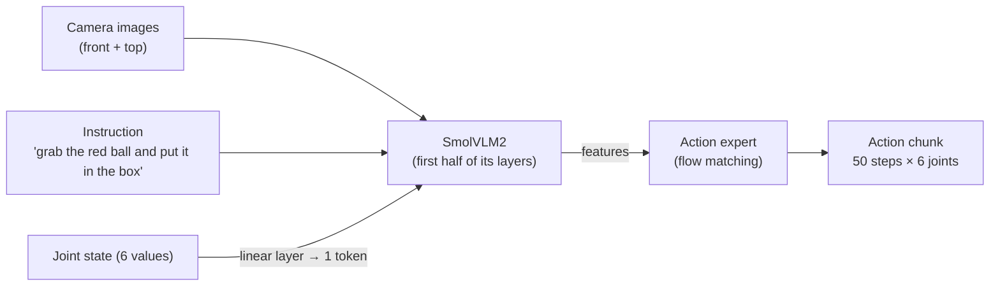

# SmolVLA: Architecture and How This Project Uses It

> Model notes for the SO-ARM 101 voice-commanded pick-and-place project.

**Paper:** [SmolVLA: A Vision-Language-Action Model for Affordable and Efficient Robotics (arXiv:2506.01844)](https://arxiv.org/abs/2506.01844) · **Blog:** [huggingface.co/blog/smolvla](https://huggingface.co/blog/smolvla) · **Checkpoint:** [`lerobot/smolvla_base`](https://huggingface.co/lerobot/smolvla_base) · **Code:** [huggingface/lerobot](https://github.com/huggingface/lerobot)
**Last updated:** 2026-10-30

---

## 1. What SmolVLA is

SmolVLA is a compact (~450M parameter) vision-language-action model from Hugging Face. It takes camera images, a text instruction and the robot's joint state, and outputs a **chunk of future actions** in one pass. It was pretrained on 487 community LeRobot datasets recorded on SO-100 arms (about 10M frames), which makes it a natural fit for the SO-ARM 101.

It has two parts:

| Part | What it is | Role |
|---|---|---|
| Vision-language model (VLM) | **SmolVLM2-500M**: a SigLIP vision encoder + a SmolLM2 language decoder | Reads the images, the instruction and the state token, and produces features |
| Action expert | A ~100M-parameter transformer | Turns those features into a continuous action chunk using **flow matching** |

## 2. Inputs and outputs

- **Images:** each frame is reduced to **64 visual tokens** (PixelShuffle), so several cameras stay cheap.
- **State:** the joint positions are projected into a single token by a linear layer.
- **Output:** a chunk of future joint targets. This project uses `chunk_size=50`; the runner executes the chunk and asks for a new one when it runs out.

## 3. Three design choices that make it small and fast

1. **Layer skipping.** The action expert reads VLM features from only the first half of the VLM's layers. This roughly halves compute for both parts.
2. **Interleaved attention.** Action-expert layers alternate between *cross-attention* (actions look at the VLM features) and *causal self-attention* (each action looks only at earlier actions in the chunk).
3. **Asynchronous inference (optional).** The next chunk can be computed while the current one is still executing. The authors report the same success rate (~78%) as synchronous inference, with tasks finishing about 30% faster. This project runs synchronously inside one control loop.

## 4. Flow matching in one paragraph

During training, the true action chunk from a demonstration is mixed with random noise. The action expert learns to predict the direction that moves the noisy chunk back toward the true one. At inference time it starts from pure noise and follows that predicted direction for a few steps until it reaches a clean action chunk. This produces smooth, continuous motion instead of picking from a fixed set of discrete actions.

## 5. How this project fine-tunes it

| Setting | Value | Why |
|---|---|---|
| Base checkpoint | `lerobot/smolvla_base` | Already pretrained on SO-100 data |
| Trainable part | Action expert only (`train_expert_only=True`); vision encoder frozen (`freeze_vision_encoder=True`) | Fits an 8 GB laptop GPU and avoids overfitting a small dataset |
| Batch size | 8 | 16 spilled into Windows shared GPU memory (much slower); 64 ran out of memory |
| Precision | AMP (`use_amp=True`) | Required to fit in 8 GB |
| Speed | ~1h17m per 10k steps | RTX 5070 Laptop GPU |
| Cameras | `front` → `camera1`, `top` → `camera2` | Renamed to match the keys the policy expects |
| Image augmentation | Color/saturation jitter **off** | Color jitter can change what "red" looks like and confuses color grounding |

One finding from the experiments: with a LoRA setup the base weights are already frozen, so `train_expert_only` has no extra effect there.

## 6. Lesson: language grounding comes from the data

A single policy trained on instructions for both colors looked successful under a loose metric (any ball in the box). Swapping the instruction string at inference showed the policy ignored the color word and picked at random. The demonstrations covered only about 8 distinct scenes, so the policy memorised scene layouts instead of linking the word "red" to the red ball.

What this implies for the dataset:

- Both colors must appear in **every** episode, in overlapping positions, so the only way to tell them apart is the instruction.
- The success criterion must check that the **named** ball was moved, not just any ball.

The current demo sidesteps this with one checkpoint per color, switched by voice (see [VoiceRun.md](./VoiceRun.md)). The "red" checkpoint is not red-only: it was trained on `SmolVla_dataset5` (160 episodes, half with the red instruction and half with the black one) and is always run with the red instruction. The "black" checkpoint was trained on 89 black-only episodes (`SmolVla_grab_blackball`).

## 7. References

- Shukor et al., *SmolVLA: A Vision-Language-Action Model for Affordable and Efficient Robotics*, [arXiv:2506.01844](https://arxiv.org/abs/2506.01844)
- Hugging Face blog: [SmolVLA: Efficient Vision-Language-Action Model trained on Lerobot Community Data](https://huggingface.co/blog/smolvla)
- LeRobot SmolVLA docs: [huggingface.co/docs/lerobot/smolvla](https://huggingface.co/docs/lerobot/smolvla)
- SO-101 hardware: [huggingface.co/docs/lerobot/so101](https://huggingface.co/docs/lerobot/so101)
